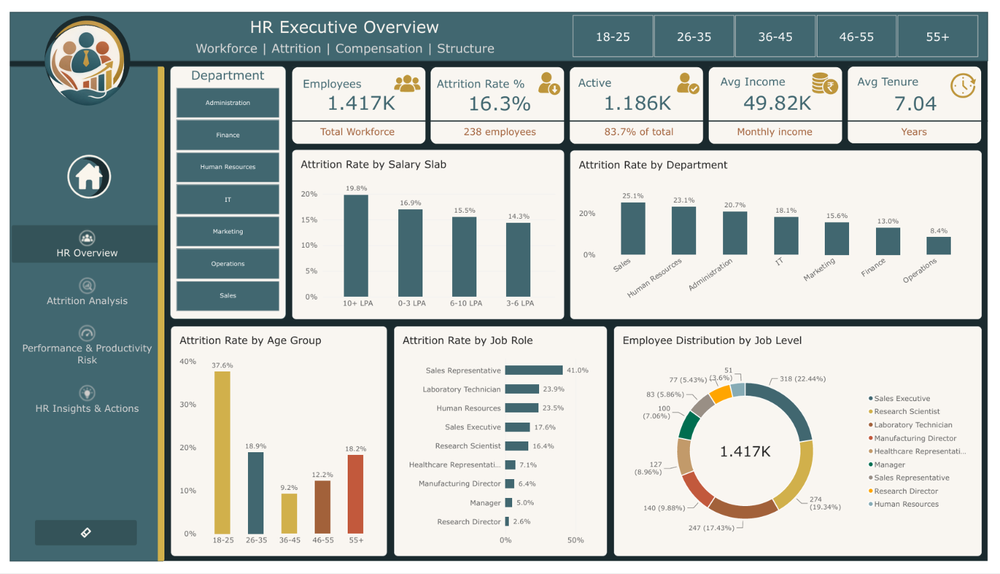
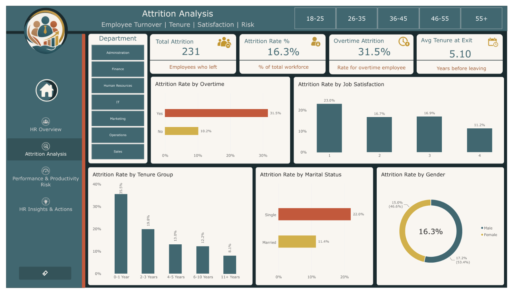
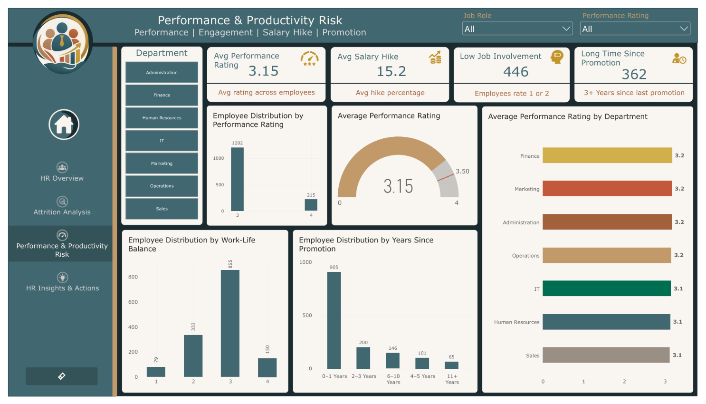
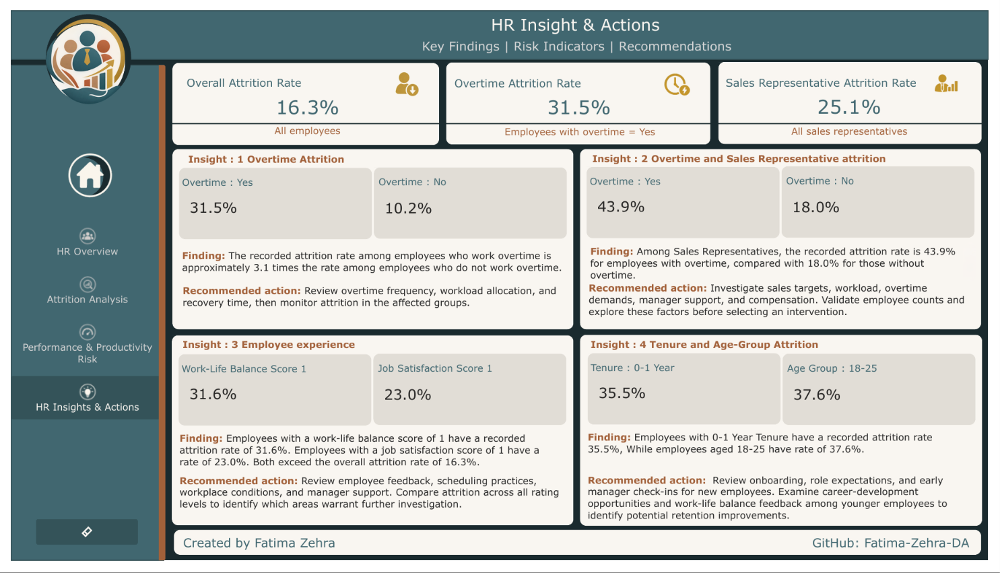

# HR Analysis Dashboard | Power BI

**Understanding Employee Attrition, Workforce Structure, and Performance Indicators**

An HR analytics project developed in Power BI to explore employee attrition patterns, workforce composition, compensation, employee experience, and performance-related indicators.

The objective is to turn HR data into meaningful findings that can help identify employee groups with higher recorded attrition and highlight areas where further investigation or retention initiatives may be valuable.

## Project Overview

Employee attrition can affect workforce stability, recruitment costs, knowledge retention, and business continuity. Understanding where attrition is concentrated can help HR teams investigate potential risk factors and make more informed decisions.

In this project, I analyzed employee-level HR data and built a four-page Power BI dashboard to examine workforce structure, attrition patterns, performance indicators, and actionable HR insights.

Rather than focusing only on the overall attrition rate, the analysis explores how attrition varies across employee tenure, age groups, overtime status, job satisfaction, work-life balance, and job roles.

**Project type:** Exploratory HR Analytics and Business Intelligence
**Tool:** Microsoft Power BI
**Core skills:** Data Cleaning, Data Quality Assessment, Data Modeling, DAX, Data Visualization, Exploratory Data Analysis, and Insight Communication

## Business Problem

The project focuses on two central business questions:

1. **Why are employees leaving?** Identify employee groups with higher recorded attrition and examine how attrition varies across relevant workforce characteristics.
2. **Where should HR investigate potential performance and retention risks?** Explore performance ratings, job involvement, salary hikes, promotion timelines, and employee experience indicators.

The analysis is intended to identify patterns and potential areas for further investigation. The observed relationships do not, by themselves, establish the causes of employee attrition or changes in productivity.

## Project Objectives

* Understand the overall workforce composition and attrition rate.
* Compare attrition across departments, job roles, salary slabs, and age groups.
* Examine attrition patterns by overtime, tenure, job satisfaction, marital status, and gender.
* Explore performance ratings and employee distribution across work-life balance scores.
* Review job involvement, salary hike percentages, and time since the last promotion.
* Translate the findings into practical areas for HR investigation.
* Build a consistent, interactive, multi-page Power BI report.

<!-- ## Dashboard Preview -->

<!--  -->

*The report contains four pages: HR Executive Overview, Attrition Analysis, Performance & Productivity Risk, and HR Insight & Actions.*

## Dashboard Pages

### 1. HR Executive Overview

**Subtitle:** Workforce | Attrition | Compensation | Structure

This page provides a high-level overview of the workforce and helps users identify where attrition is concentrated.

**Key metrics**

* Total employee records: 1,417
* Active employees: 1,186
* Employees who left: 231
* Overall attrition rate: 16.3%
* Average income: 49.82K
* Average tenure: 7.04 years

**Visualizations**

* Attrition rate by salary slab
* Attrition rate by department
* Attrition rate by age group
* Attrition rate by job role
* Employee distribution by job level

**Purpose:** Provide a starting point for understanding workforce composition and identifying departments, roles, salary groups, and age groups that warrant closer examination.



### 2. Attrition Analysis

**Subtitle:** Employee Turnover | Tenure | Satisfaction | Risk

This page examines attrition across employee experience, working conditions, and demographic segments.

**Key metrics**

* Total attrition: 231 employees
* Overall attrition rate: 16.3%
* Overtime attrition rate: 31.5%
* Average tenure at exit: 5.10 years

**Visualizations**

* Attrition rate by overtime status
* Attrition rate by job satisfaction
* Attrition rate by tenure group
* Attrition rate by marital status
* Attrition rate by gender

**Purpose:** Identify employee groups with higher recorded attrition and explore how turnover patterns differ across working conditions, satisfaction levels, and tenure.



### 3. Performance & Productivity Risk

**Subtitle:** Performance | Engagement | Salary Hike | Promotion

This page explores performance-related and employee experience indicators to identify areas that may need additional attention.

**Key metrics**

* Average performance rating: 3.15
* Average salary hike: 15.2%
* Employees with low job involvement scores (1 or 2): 446
* Employees with three or more years since their last promotion: 362

**Visualizations**

* Employee distribution by performance rating
* Average performance rating indicator
* Average performance rating by department
* Employee distribution by work-life balance score
* Employee distribution by years since last promotion

**Purpose:** Review the distribution of performance and engagement indicators, compare department-level averages, and identify employee groups that may benefit from further investigation.

These indicators should be interpreted in context. A high number of employees waiting for a promotion, for example, does not by itself demonstrate that promotion delays are causing attrition or reduced productivity.



### 4. HR Insight & Actions

**Subtitle:** Key Findings | Risk Indicators | Recommendations

This page brings the analysis together into four insight areas, with findings and suggested HR follow-up actions.

**Insight 1 — Overtime and Attrition**

* Overtime group attrition rate: 31.5%
* Non-overtime group attrition rate: 10.2%

**Finding:** The recorded attrition rate among employees working overtime is approximately three times the rate among employees not working overtime.

**Suggested action:** Investigate overtime frequency, workload allocation, recovery time, and employee feedback within the affected groups.

**Insight 2 — Overtime and Sales Representative Attrition**

* Sales Representatives working overtime: 43.9%
* Sales Representatives not working overtime: 18.0%
* Overall Sales Representative attrition rate: 25.1%

**Finding:** Sales Representatives working overtime have a higher recorded attrition rate than those not working overtime.

**Suggested action:** Examine workload, sales targets, overtime expectations, and team-level working conditions before selecting a retention intervention.

**Insight 3 — Employee Experience**

* Work-life balance score of 1: 31.6% attrition rate
* Job satisfaction score of 1: 23.0% attrition rate

**Finding:** The lowest recorded work-life balance and job satisfaction scores are associated with higher attrition rates in this dataset.

**Suggested action:** Review employee feedback, scheduling practices, workload conditions, and manager support. Compare these findings with other satisfaction levels before prioritizing interventions.

**Insight 4 — Tenure and Age Group**

* Employees with 0–1 year of tenure: 35.5% attrition rate
* Employees aged 18–25: 37.6% attrition rate

**Finding:** Early-tenure employees and employees in the youngest age group show higher recorded attrition rates than the overall workforce.

**Suggested action:** Review onboarding, role expectations, early-career development, manager check-ins, and opportunities for new employees to receive support.

**Purpose:** Convert descriptive analysis into specific questions HR can investigate and potential actions that can be evaluated using additional evidence.



## Key Findings at a Glance

| Metric or segment                            | Result |
| -------------------------------------------- | -----: |
| Overall attrition rate                       |  16.3% |
| Employees who left                           |    231 |
| Overtime group attrition rate                |  31.5% |
| Non-overtime group attrition rate            |  10.2% |
| Sales Representative attrition rate          |  25.1% |
| Sales Representatives working overtime       |  43.9% |
| Attrition rate for 0–1 year tenure           |  35.5% |
| Attrition rate for ages 18–25                |  37.6% |
| Attrition rate for work-life balance score 1 |  31.6% |
| Attrition rate for job satisfaction score 1  |  23.0% |

*Rates represent observed patterns in the analyzed dataset. Differences between groups should not be interpreted as proof of causation.*

## Data Preparation and Quality Assessment

Data preparation and quality checks are important parts of this project because unreliable employee records can affect the interpretation of HR metrics.

The preparation workflow included:

* Inspecting the dataset structure and column types.
* Reviewing missing values and duplicate records.
* Removing 61 rows with null values in `YearsWithCurrManager`.
* Standardizing inconsistent `BusinessTravel` category labels, including `Travel_Rarely` and `TravelRarely`.
* Removing two duplicate rows identified during the initial data-quality review.
* Investigating employee identifiers associated with conflicting records.

### Data Quality Considerations

During the audit, I identified 14 employee numbers associated with multiple records containing a value of 2 in `EmpCount`. Further investigation revealed conflicting employee information in some cases, including different salary slabs for employee number 2055 and different manager-tenure values for employee number 1331.

This highlighted an important distinction between counting employee records and counting unique employee identifiers.

The report displays 1,417 employee records, while a distinct employee count returns 1,403 identifiers. These figures should not automatically be treated as equivalent to the number of verified unique employees.

Conflicting records require careful validation before they can be consolidated or used to make employee-level conclusions. The displayed attrition metrics should therefore be interpreted in light of the dataset's quality limitations.

## Technical Approach

### Tools and Technologies

* **Microsoft Power BI Desktop** — report development and visualization
* **Power Query** — data cleaning, transformation, and standardization
* **DAX** — KPI calculations and analytical measures
* **Data visualization** — interactive charts, KPI cards, and report navigation
* **HR analytics** — workforce segmentation and attrition analysis

### Analysis Workflow

1. **Understand the data:** Review available employee, attrition, compensation, satisfaction, and performance fields.
2. **Audit data quality:** Check missing values, duplicates, inconsistent categories, and conflicting employee records.
3. **Prepare the data:** Apply appropriate cleaning and transformation steps in Power Query.
4. **Define metrics:** Create measures for attrition, workforce counts, and performance indicators.
5. **Explore patterns:** Compare attrition across employee segments and examine workforce distributions.
6. **Build the report:** Organize the findings into four dashboards with a consistent visual design.
7. **Interpret results:** Identify notable patterns, document limitations, and propose areas for HR investigation.

## DAX Measures

The following are examples of the key measures used in the analysis. Adjust the column names if your final Power BI model uses different names.

### 1. Total Attrition

```dax
Total Attrition =
SUM(EmpData[Attrition_count])
```

### 2. Attrition Rate

```dax
Attrition Rate % =
DIVIDE(
    SUM(EmpData[Attrition_count]),
    SUM(EmpData[EmployeeCount]),
    0
)
```

Format this measure as a percentage in Power BI.

### 3. Average Performance Rating

```dax
Avg Performance Rating =
AVERAGE(EmpData[PerformanceRating])
```

These examples are included to demonstrate the calculation approach. The complete DAX implementation depends on the final model and the measures used for each visual.

## Design and Interactivity

The report uses a consistent teal and gold visual theme, with a shared navigation layout across all four pages.

Design features include:

* KPI cards for important workforce metrics.
* Consistent page navigation.
* Age-group slicers on relevant pages.
* Job-role and performance-rating filters on the Performance & Productivity Risk page.
* Charts for comparing attrition rates and workforce distributions.
* A dedicated insights page connecting findings with recommended follow-up actions.

The layout is designed to make the report easy to navigate while keeping key metrics and analytical findings visible.

## Limitations and Next Steps

This project is a descriptive analysis of the available dataset. It does not establish causal relationships between employee characteristics and attrition, nor does it independently measure productivity decline.

Potential next steps include:

* Validating conflicting employee records and identifier uniqueness.
* Comparing attrition across more employee segments while accounting for group sizes.
* Investigating whether overtime, satisfaction, tenure, and other factors overlap.
* Reviewing the relationship between promotion timelines, performance ratings, and attrition.
* Evaluating retention initiatives against defined measures over time.
* Developing additional analysis once reliable longitudinal HR data becomes available.

## What I Learned

Through this project, I practiced:

* Preparing HR data in Power Query.
* Investigating data-quality issues before interpreting results.
* Building DAX measures for workforce and attrition KPIs.
* Designing a multi-page Power BI dashboard.
* Comparing attrition rates across employee segments.
* Communicating findings without presenting correlations as proven causes.
* Translating analytical observations into practical questions for business stakeholders.

## Repository Contents

* `README.md` — project documentation, methods, and findings.
* `images/` — dashboard screenshots used in this README.
* `HR_Analysis_Dashboard.pbix` — Power BI report file, if included in the repository.

## Conclusion

This project demonstrates how HR data can be organized into a structured Power BI report to explore employee attrition, workforce composition, and performance-related indicators.

The main takeaway is that attrition is not evenly distributed across every employee group. Overtime status, early tenure, work-life balance, job satisfaction, and specific job roles highlight areas that may warrant further investigation.

The dashboard provides a starting point for evidence-based HR discussions, while data validation and additional analysis remain important before making operational decisions.


## 👩‍💻 Author

**Fatima Zehra**

Aspiring Data Analyst focused on transforming data into meaningful business insights.


## Connect with me

I am building my skills in data analytics, business intelligence, and data visualization through practical projects.

[](https://github.com/Fatima-Zehra-DA)
[](https://www.linkedin.com/in/fatima-zehra-308b85358/)
[](https://public.tableau.com/app/profile/fatima.zehra7709/vizzes)
[](https://www.kaggle.com/fatimazehra2305/)
[](mailto:fatimazehra2305@gmail.com)

Thank you for visiting my project!
